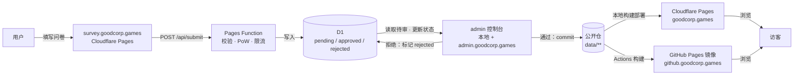
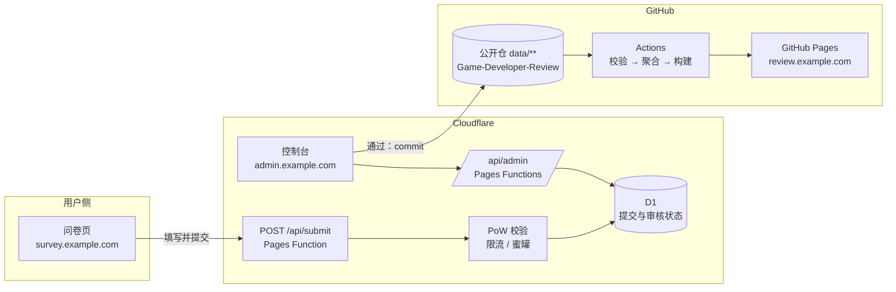
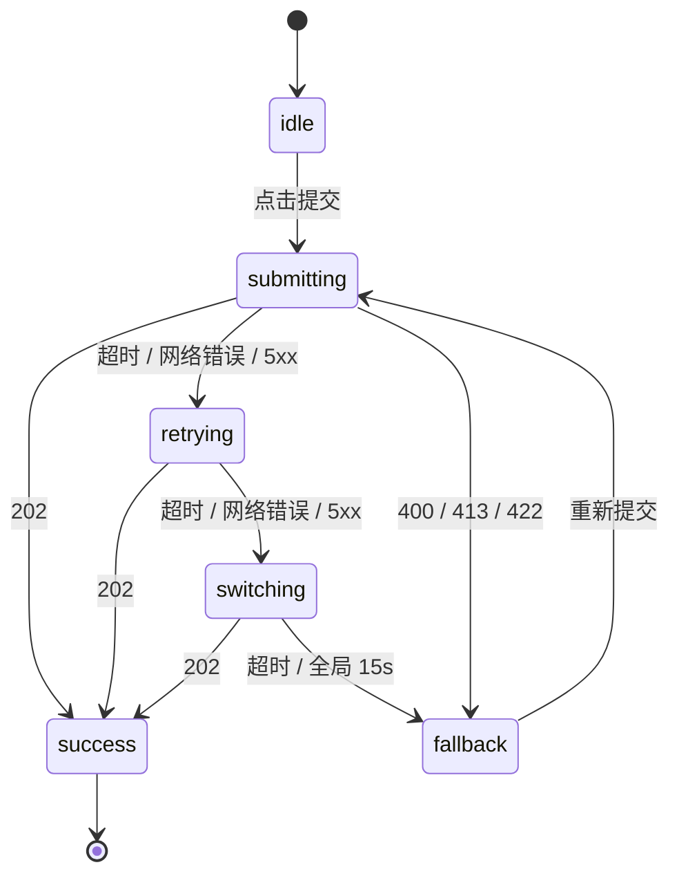

# 游戏行业匿名评价平台 · 技术方案

> 版本 v0.3 ｜ 2026-11-23 ｜ 状态：已上线
> 变更：启用 `goodcorp.games`；三条 Cloudflare Pages 生产链路 + GitHub Pages 镜像
> 目标仓库：`bkbdq/Game-Developer-Review`（PUBLIC）
> 对应流程：用户问卷 → 控制台人工审核 → 自动写入数据源 → 对外展示

---

## 0. 一页架构说明

### 0.1 一句话

匿名收集游戏行业公司与项目评价：问卷提交 → D1 待审队列 → 管理员审核 → 写入公开 GitHub 仓库 → Cloudflare Pages 展示 + GitHub Pages 镜像。**Cloudflare D1 保存提交与审核状态，GitHub 公开仓是已发布数据的唯一长期数据源。**

### 0.2 架构总览



### 0.3 组件与边界

| 组件 | 位置 | 职责 | 存什么 | 对外可见 |
| --- | --- | --- | --- | --- |
| 问卷页 | Cloudflare Pages | 收表、校验、提交 | 无 | 是 |
| 提交 API | Cloudflare Pages Functions | 校验、PoW、限流、写 D1 | 无 | 是（API） |
| D1 | Cloudflare | 待审队列、审核状态、审计 | 原始提交、拒绝原因、审计记录 | 否 |
| 控制台 | Cloudflare Pages + 本地 | 审核、脱敏、发布、状态更新 | 无 | 仅管理员 |
| 公开仓 | GitHub Public | 已审核数据、站点源码 | 公开 JSON | 是 |
| Cloudflare Pages | Cloudflare | 静态展示（正式站） | 构建产物 | 是 |
| GitHub Pages | GitHub | 静态展示（镜像站） | 构建产物 | 是 |

### 0.4 四条链路

1. **提交**：问卷 → 提交 API → D1（`pending`）→ 202 回执。用户在此结束，最长等 15 秒。
2. **审核**：控制台读 D1 待审队列 → 编辑/脱敏 → 通过写公开仓并标记 `approved`，或拒绝并标记 `rejected`。
3. **发布**：公开仓 push → 本地审核台构建 `data/` 并部署 Cloudflare 正式站；GitHub Actions 同步构建 GitHub Pages 镜像。
4. **备用**：主端点不可用时，客户端切到第二境外端点，写入同一个 D1 队列。

### 0.5 三条硬约束

- **全链路境外**：Cloudflare + GitHub，域名在境外注册；不用国内云、CDN、问卷平台、统计、邮件。
- **提交成功率优先**：展示速度可以慢；提交必须有超时、重试、双端点、本地暂存。
- **公开数据只从公开仓出**：原始提交只存 D1，审核通过后才以 commit 形式进入公开仓；Git 历史即发布数据的长期版本记录。

### 0.6 技术选型

| 层 | 选型 |
| --- | --- |
| 问卷 / 控制台 | Astro 或 Vite + React，静态部署 Cloudflare Pages |
| 提交 API | Cloudflare Pages Functions |
| 提交队列与审核状态 | Cloudflare D1 |
| 数据 / 发布 | GitHub 公开仓 + 本地构建 + Cloudflare Pages + GitHub Actions 镜像 |
| 数据契约 | JSON Schema + `/data/v1/*.json` |
| 域名 | `goodcorp.games`，Cloudflare DNS |

> 成本 ≈ 一个域名；GitHub、Cloudflare 均在免费额度内。

---

## 1. 目标与非目标

### 1.1 目标

1. 匿名收集对公司、项目的评分与评价正文，附加岗位、司龄、在职状态等画像字段。
2. 提交内容在审核前**不对外可见**，管理员可编辑、脱敏、合并、拒绝。
3. 审核通过后以 Git commit 形式进入公开仓，有完整版本历史与回滚能力。
4. 对外提供稳定的数据接口，展示页可自由改结构、改字段、改视觉。
5. 无长期运行的服务器、无复杂运维；仅用 D1 保存提交与审核状态，GitHub 公开仓仍是唯一长期数据源。

### 1.2 非目标（当前阶段）

- 不做用户账号体系、评论回复、点赞、社交功能。
- 不做实时提交（审核后下次构建才可见，分钟级延迟可接受）。
- 不做多管理员角色权限（先单管理员，多管理员用 GitHub 协作者即可）。
- 不做原生 App / 小程序。

---

## 2. 关键前提与边界

### 2.1 github.io 是什么

`github.io` **就是 GitHub Pages**，不是另一个产品。

- 仓库 Settings → Pages 开启后，站点地址为 `https://<用户名>.github.io/<仓库名>/`；若仓库名恰好是 `<用户名>.github.io`，则站点在根路径。
- 只能托管**静态文件**（HTML/CSS/JS/JSON/图片），不能运行服务端代码。
- 免费、自带 HTTPS、可绑定自定义域名（仓库内放 `CNAME` 文件 + DNS 解析）。
- 国内访问不稳定（跨境链路 + 偶发 DNS 问题），这是它唯一的明显短板。
- 可以用 Actions 部署任意构建产物（Vite / React / Astro 均可），不局限于 Jekyll。

### 2.2 为什么不用 GitHub 收表

| 通道 | 是否公开 | 是否要账号 | 能否私密暂存 | 结论 |
| --- | --- | --- | --- | --- |
| Issue Forms | 公开 | 要 | 否 | 审核形同虚设，匿名失效 |
| Discussions | 公开 | 要 | 否 | 同上 |
| Pull Request | 公开 | 要 | 否 | 门槛更高，且暴露提交者 |
| 私有仓 Issue | 私有 | 要（需协作者权限） | 是 | 陌生人无法提交 |

**结论：GitHub 适合当"已审核数据的数据库"，不适合当"匿名收件箱"。** 收件箱必须是第三方服务，本方案选 Cloudflare Pages Functions + D1（免费额度够用，且完全在境外）。

### 2.3 账号与配额

| 项目 | 免费额度 | 是否够用 |
| --- | --- | --- |
| GitHub 公开仓 Actions | 不限分钟 | 够 |
| GitHub Pages | 1 GB 站点、100 GB/月带宽、软限制 10 次构建/小时 | 够 |
| GitHub API（已认证） | 5,000 次/小时 | 够 |
| Cloudflare Pages | 500 次构建/月、无限静态请求 | 够 |
| Cloudflare Functions | 100,000 次请求/天 | 够 |
| Cloudflare D1 | 5 GB、10 万写/天 | 够 |

---

## 3. 总体架构



### 3.1 四条数据流

1. **写入流**：问卷 → 提交 API（PoW / 限流）→ D1 `submissions`（`status = pending`）。
2. **审核流**：控制台经 `/api/admin/*` 读 D1 → 管理员编辑/脱敏 → 通过写公开仓并标记 `approved`，或拒绝标记 `rejected`。
3. **发布流**：公开仓 push → Actions 校验 schema → 生成聚合索引 → 构建前端 → 部署 Pages。
4. **备用流**：主端点不可用时，客户端切到第二境外端点，写入同一个 D1 队列。

### 3.2 未审核数据放在哪里

公开仓的任何分支、任何 commit 都是公开可查的。把未审核内容放进公开仓的 `staging` 分支，等于直接公开。因此：

- `Game-Developer-Review`（PUBLIC）：只放**已审核**数据 + 站点代码。
- 原始提交、拒绝记录、审计日志只存 Cloudflare D1，不进入任何 Git 仓库；D1 不绑定公开域名，仅由提交 API 与控制台 API 访问。

---

## 4. 仓库与目录结构

### 4.1 公开仓（现有 `Game-Developer-Review`）

```text
Game-Developer-Review/
├─ .github/workflows/
│  ├─ data-validate.yml        # 数据变更时校验 schema
│  └─ site-deploy.yml          # 构建 + 部署 Pages
├─ data/
│  ├─ taxonomy.json            # 岗位/司龄/在职状态/城市/标签 枚举
│  ├─ companies/
│  │  └─ {companyId}.json      # 公司元数据 + 项目列表（人工维护）
│  └─ reviews/
│     └─ {companyId}/
│        └─ {reviewId}.json    # 单条已审核评价
├─ schema/
│  ├─ review.schema.json
│  ├─ company.schema.json
│  └─ taxonomy.schema.json
├─ scripts/
│  ├─ validate.mjs             # ajv 校验 + 引用完整性 + 敏感字段扫描
│  └─ aggregate.mjs            # 生成 index / 公司详情
├─ site/                       # 展示页源码（Astro 或 Vite+React）
├─ public/
└─ docs/
```

**约定**：`data/reviews` 一条评价一个文件，按公司分目录。好处是 diff 小、冲突少、单条可回滚、GitHub 上可直接阅读。

### 4.2 D1 表（Cloudflare，非 Git 仓库）

```text
submissions
├─ id             提交 UUID（主键，幂等）
├─ payload        提交原文 JSON
├─ status         pending / approved / rejected
├─ flags          风控标记
├─ ip_hash        IP 加盐哈希
├─ dedupe_hash    24 小时去重指纹
├─ created_at     提交时间
├─ reviewed_at    审核时间
├─ reviewer       审核人 GitHub 登录名
├─ review_id      通过后的评价 ID
└─ reject_reason  拒绝原因
audit_log
├─ at / action / reviewer       时间、动作、审核人
├─ submission_id / review_id / company_id
├─ result                       success / denied / failed
├─ target_type / target_id      submission / review / request / contact / session / deploy
├─ reason                       拒绝原因 / 处理说明
└─ details                      JSON，如 {"commitSha":"..."}
```

审计动作覆盖：通过、拒绝、删除、更正、驳回申请、联系已处理、登录成功 / 失败、无权限访问、更新展示站。日志只写入 D1，不进入公开仓库，也不记录正文、联系方式和 token。

D1 不绑定公开域名，只由问卷的提交 API 和控制台的 `/api/admin/*` 访问。

### 4.3 域名规划

| 域名 | 指向 | 作用 | 是否可省 |
| --- | --- | --- | --- |
| `goodcorp.games` | Cloudflare Pages `gdr-site` | 对外展示（正式站） | 否 |
| `www.goodcorp.games` | Cloudflare Pages `gdr-site` | 301 到主域 | 可省 |
| `dev.goodcorp.games` | Cloudflare Pages `gdr-site-dev` | 开发预览，带 `data-test/` | 可省 |
| `survey.goodcorp.games` | Cloudflare Pages `gdr-survey` | 问卷 + `/api/submit` | 必须，需能跑 Function |
| `admin.goodcorp.games` | Cloudflare Pages `gdr-admin` | 审核控制台 API | 必须 |
| `github.goodcorp.games` | GitHub Pages | 镜像站，DNS CNAME 到 `bkbdq.github.io` | 可省 |

> 控制台单独子域是为了隔离 token：即使展示站被注入，也读不到管理员的 localStorage。
>
> **当前实际部署**：`goodcorp.games` 的 zone 托管在 Cloudflare，所有 Pages 项目绑定同域子域；GitHub Pages 仅作为镜像入口。旧 `gdr-*.pages.dev` 和 `www` 通过 Pages Functions `_middleware.js` 按 Host 301 到新域名。

---

## 5. 数据契约（核心）

> 这一节是展示端与数据端唯一需要对齐的部分。展示页开发者只需依赖这里，不必关心收集与审核怎么实现。

### 5.1 版本与兼容规则

- 所有对外文件都带 `schemaVersion: 1`。
- **只增不改**：新增字段必须可选；前端遇到未知字段一律忽略。
- 破坏性变更 → 新路径 `/data/v2/`，旧路径保留至少一个版本周期。
- 枚举值用英文 `key`，中文 `label` 从 `taxonomy.json` 读取，前端不硬编码中文。
- 日期统一 ISO 8601：日期用 `YYYY-MM-DD`，时间用带时区的完整格式。
- ID 稳定不变：评价 ID 一旦发布永不修改（修订用 `revision` 递增）。

### 5.2 提交结构（仅存 D1，永不公开）

```jsonc
{
  "schemaVersion": 1,
  "submissionId": "sub_01JCV7Z3K9Q2M",
  "submittedAt": "2026-11-19T14:32:10+08:00",
  "formVersion": "1.0",
  "payload": {
    "company": "用户填写的公司名（原文）",
    "project": "用户填写的项目名（原文）",
    "score": 3,
    "comment": "事实与感受",
    "wish": "希望被吐槽的内容（选填）",
    "profile": {
      "role": "design",
      "tenure": "1-3y",
      "employment": "former",
      "city": "shanghai"
    },
    "consent": true
  },
  "meta": {
    "ipHash": "sha256(salt + ip) 前16位",
    "uaFamily": "Chrome/Windows",
    "turnstile": "pass",
    "country": "CN"
  }
}
```

说明：
- `payload.company/project` 是用户原文，允许错别字、简称、别名，由管理员归一化。
- `meta.ipHash` 只用于 24 小时内的重复提交判定，30 天后由定时任务清除。
- 拒绝记录会保留 `rejectReason`，但同样只存在 D1（`rejected` 状态）。

### 5.3 公开评价 Review

```jsonc
{
  "schemaVersion": 1,
  "id": "rv_01JCV8A2B7",
  "companyId": "c_mihoyo",
  "projectId": "p_genshin",
  "score": 4,
  "title": "（选填）一句话结论",
  "comment": "已脱敏的评价正文",
  "profile": {
    "role": "program",
    "tenure": "3-5y",
    "employment": "former",
    "city": "shanghai"
  },
  "tags": ["overtime", "management"],
  "publishedAt": "2026-11-19",
  "revision": 1
}
```

字段规则：

| 字段 | 类型 | 必填 | 说明 |
| --- | --- | --- | --- |
| `id` | string | 是 | `rv_` + ULID，发布后不变 |
| `companyId` | string | 是 | 必须存在于 `data/companies/` |
| `projectId` | string | 否 | 必须存在于该公司的 `projects` |
| `score` | 1–5 整数 | 是 | 问卷里的打分 |
| `title` | string | 否 | 管理员可补，≤ 40 字 |
| `comment` | string | 是 | 脱敏后正文，≤ 2000 字 |
| `profile` | object | 否 | 全部子字段可选 |
| `tags` | string[] | 否 | 管理员标注，key 来自 taxonomy |
| `publishedAt` | string | 是 | 审核通过日期 |
| `revision` | number | 是 | 每次修订 +1 |

**不在公开数据里出现的字段**：IP、UA、提交时间戳（精确到分钟）、联系方式、审核人、拒绝原因。

### 5.4 公司与项目元数据（人工维护）

```jsonc
{
  "schemaVersion": 1,
  "id": "c_mihoyo",
  "slug": "mihoyo",
  "name": "米哈游",
  "aliases": ["miHoYo", "米忽悠"],
  "projects": [
    {
      "id": "p_genshin",
      "name": "原神",
      "status": "live",
      "genre": "open-world"
    }
  ],
  "createdAt": "2026-11-01",
  "updatedAt": "2026-11-19"
}
```

- `aliases` 用于审核台的自动匹配，避免同一家公司被拆成多条。
- `status` 枚举：`live` 已上线 / `dev` 在研 / `cancelled` 已取消 / `unknown`。
- 公司名默认使用工商/公开名称；是否展示真实公司名是产品决策，见 §13。

### 5.5 Taxonomy（枚举字典）

```jsonc
{
  "schemaVersion": 1,
  "roles": [
    { "key": "design", "label": "策划" },
    { "key": "program", "label": "程序" },
    { "key": "art", "label": "美术" },
    { "key": "audio", "label": "音频" },
    { "key": "ops", "label": "运营" },
    { "key": "qa", "label": "测试" },
    { "key": "pm", "label": "项目管理" },
    { "key": "other", "label": "其他" }
  ],
  "tenures": [
    { "key": "lt1y", "label": "1 年以内" },
    { "key": "1-3y", "label": "1–3 年" },
    { "key": "3-5y", "label": "3–5 年" },
    { "key": "gt5y", "label": "5 年以上" }
  ],
  "employments": [
    { "key": "current", "label": "在职" },
    { "key": "former", "label": "已离职" },
    { "key": "intern", "label": "实习" }
  ],
  "cities": [
    { "key": "beijing", "label": "北京" },
    { "key": "shanghai", "label": "上海" },
    { "key": "guangzhou", "label": "广州" },
    { "key": "shenzhen", "label": "深圳" },
    { "key": "chengdu", "label": "成都" },
    { "key": "hangzhou", "label": "杭州" },
    { "key": "other", "label": "其他" }
  ],
  "tags": [
    { "key": "overtime", "label": "加班" },
    { "key": "management", "label": "管理" },
    { "key": "welfare", "label": "福利" },
    { "key": "project", "label": "项目质量" },
    { "key": "layoff", "label": "裁员" }
  ]
}
```

新增岗位或标签 = 改这一份 JSON，前端不需要发版。

### 5.6 展示端接口清单

构建时由 `scripts/aggregate.mjs` 生成，随站点一起部署：

| 方法 | 路径 | 用途 | 体积预估 |
| --- | --- | --- | --- |
| GET | `/data/v1/manifest.json` | 版本、生成时间、总数，用于缓存判断 | < 1 KB |
| GET | `/data/v1/index.json` | 公司列表 + 聚合评分，列表页/搜索用 | 每公司约 300 B |
| GET | `/data/v1/companies/{companyId}.json` | 单公司详情 + 全部评价 + 分画像统计 | 每条评价约 500 B |
| GET | `/data/v1/taxonomy.json` | 枚举字典 | < 5 KB |

**`index.json`**

```jsonc
{
  "schemaVersion": 1,
  "generatedAt": "2026-11-19T16:00:00+08:00",
  "totals": { "companies": 42, "projects": 87, "reviews": 318 },
  "companies": [
    {
      "id": "c_mihoyo",
      "slug": "mihoyo",
      "name": "米哈游",
      "reviewCount": 12,
      "projectCount": 3,
      "avgScore": 3.2,
      "medianScore": 3,
      "scoreDistribution": { "1": 1, "2": 2, "3": 4, "4": 3, "5": 2 },
      "lastPublishedAt": "2026-11-19",
      "topTags": [{ "key": "overtime", "count": 5 }]
    }
  ]
}
```

**`companies/{companyId}.json`**

```jsonc
{
  "schemaVersion": 1,
  "company": {
    "id": "c_mihoyo",
    "slug": "mihoyo",
    "name": "米哈游",
    "aliases": ["miHoYo"],
    "reviewCount": 12,
    "avgScore": 3.2,
    "scoreDistribution": { "1": 1, "2": 2, "3": 4, "4": 3, "5": 2 }
  },
  "projects": [
    {
      "id": "p_genshin",
      "name": "原神",
      "status": "live",
      "reviewCount": 8,
      "avgScore": 3.4
    }
  ],
  "byProfile": {
    "role": [{ "key": "program", "count": 5, "avgScore": 3.6 }],
    "tenure": [],
    "employment": [],
    "city": []
  },
  "reviews": [
    {
      "schemaVersion": 1,
      "id": "rv_01JCV8A2B7",
      "companyId": "c_mihoyo",
      "projectId": "p_genshin",
      "score": 4,
      "comment": "……",
      "profile": { "role": "program", "tenure": "3-5y", "employment": "former" },
      "tags": ["overtime"],
      "publishedAt": "2026-11-19",
      "revision": 1
    }
  ]
}
```

**前端类型（由 schema 生成，可直接放进展示项目）**

```ts
export type Score = 1 | 2 | 3 | 4 | 5;

export interface ReviewProfile {
  role?: string;
  tenure?: string;
  employment?: string;
  city?: string;
}

export interface Review {
  schemaVersion: 1;
  id: string;
  companyId: string;
  projectId?: string;
  score: Score;
  title?: string;
  comment: string;
  profile?: ReviewProfile;
  tags?: string[];
  publishedAt: string;
  revision: number;
}
```

### 5.7 缓存策略

- `index.json`：`Cache-Control: no-cache`，前端每次协商缓存。
- 详情文件：`?v={generatedAt}` 做缓存击穿，或依赖 Pages 的 ETag。
- 构建产物文件名带 hash，静态资源长缓存。

### 5.8 数据量与分片

- 1 万条评价、每条约 500 B ≈ 5 MB，单公司文件通常 < 200 KB，无需分页。
- 超过 1 万条：`companies/{id}.json` 拆为 `meta` + `reviews-{page}.json`，接口版本升到 v2。
- 公司列表不做分页，前端本地过滤/排序即可（几千家公司仍在数百 KB 量级）。

---

## 6. 提交流程

### 6.1 问卷页

- 技术栈：静态站点（Astro / Vite + React），部署 Cloudflare Pages，必须绑定自定义域名，不使用 `pages.dev`。
- 字段：公司名、项目名、打分（必填）、评价正文（必填）、"希望被吐槽的"（选填）、画像四项（选填）、同意条款（必选）。
- 交互：提交中禁用按钮 → 成功展示回执编号 → 失败可重试；不做多步分页，保持一屏可完成。
- 提交使用标准 `<form method="post" action="/api/submit">`，JS 只做增强；脚本加载失败时表单仍能提交。
- 页面不引任何第三方资源（字体、统计、验证码、CDN），全部同源内联。
- 不做登录、不收集邮箱手机号。

### 6.2 `POST /api/submit`

Cloudflare Pages Function 负责接收，写入 D1；控制台直接读取同一张表，不再有同步任务。

处理顺序：

1. 解析请求：同时支持 `application/x-www-form-urlencoded`（原生表单）和 `application/json`（JS fetch）。
2. 校验 body 大小（≤ 16 KB）、字段长度（公司 ≤ 50 字，评价 ≤ 2000 字）。
3. 蜜罐字段非空，或提交耗时 < 3 秒 → 标记 `suspected`，正常入库并返回 202，不丢弃，交人工审核判断。
4. 校验 PoW（仅 JS 路径）：客户端提交 `nonce`，提交 API 验证 `sha256(challenge + nonce)` 前 N 位为 0；原生表单路径跳过，标记 `no_js`。
5. 归一化：去首尾空白、合并连续换行、限制 URL 数量（≤ 2 个，防广告）。
6. 以 `ipHash` 做宽松限流：1 分钟 5 次、24 小时 100 次（D1 计数）；办公网 NAT 会让多人共享出口 IP，不能按个位数/天卡。
7. 客户端在首次提交前生成 `submissionId`（UUID/ULID）并随请求发送；服务端校验格式后以它为主键 `INSERT ... ON CONFLICT DO NOTHING`，重试天然幂等。写入 D1，状态 `pending`。
8. 立即返回 `202 { "receipt": "sub_..." }`。此时数据已持久化，不依赖 GitHub 是否可用。
9. 审核通过前，记录只在 D1；控制台读取待审队列，发布时才写公开仓。

原生表单提交时，第 8 步返回一个简单 HTML 回执页而不是 JSON，保证无 JS 也能完成闭环。

D1 表结构：

```sql
CREATE TABLE submissions (
  id TEXT PRIMARY KEY,
  payload TEXT NOT NULL,
  status TEXT NOT NULL DEFAULT 'pending',  -- pending / approved / rejected
  flags TEXT,
  ip_hash TEXT,
  dedupe_hash TEXT,
  created_at TEXT NOT NULL,
  reviewed_at TEXT,
  reviewer TEXT,
  review_id TEXT,
  reject_reason TEXT
);

CREATE TABLE audit_log (
  id INTEGER PRIMARY KEY AUTOINCREMENT,
  at TEXT NOT NULL,
  action TEXT NOT NULL,
  reviewer TEXT NOT NULL,
  submission_id TEXT NOT NULL,
  review_id TEXT,
  company_id TEXT,
  reason TEXT
);
```

失败返回统一 `{ "ok": false, "code": "RATE_LIMITED" | "INVALID_INPUT" | "POW_FAILED" | "UPSTREAM" }`，不暴露内部细节。

### 6.3 防刷

| 手段 | 说明 | 成本 |
| --- | --- | --- |
| PoW | JS 路径必过，原生表单跳过并标记 `no_js` | 0 |
| 蜜罐字段 | 隐藏 input，命中后标记 `suspected`，不丢弃 | 0 |
| 提交耗时 | 少于 3 秒标记 `fast_submit`，交人工判断 | 0 |
| 频率限制 | 同 IP 哈希 1 分钟 5 次、24 小时 100 次 | D1 |
| 内容限制 | 长度、URL 数、纯重复文本 | 0 |
| 去重 | `hash(company+project+comment)` 24 小时内重复直接拒 | 0 |
| 人工审核 | 最后一道防线 | 人力 |

不使用 Turnstile / reCAPTCHA：它们依赖境外验证域名，在大陆可能加载失败，会直接拉低提交成功率。

限流必须宽松：游戏公司办公网常共用出口 IP，按 5 次/天会直接误伤同事。风控标记只用于审核排序，不作为拒绝依据。

### 6.4 控制台的 GitHub 凭据

- 管理员使用 **fine-grained PAT**，仅授权 `Game-Developer-Review` 一个仓库的 `Contents: Read and write`。
- 浏览器把 PAT 存在 `sessionStorage`，随 `/api/admin/*` 请求发送；控制台 API 每次校验 token 身份与该仓库写权限。
- PAT 设置有效期（≤ 1 年），到期前更换；失效只影响审核控制台，不影响问卷提交。

### 6.5 大陆提交成功率设计（境外-only）

目标不是"页面快"，而是"点了提交能成功"。措施按重要性排序：

1. **自定义域名**：不使用 `pages.dev` / `workers.dev`，域名在境外注册商注册（Cloudflare Registrar、Porkbun、Namecheap），DNS 放 Cloudflare。
2. **关闭提交路径上的安全产品**：Bot Fight Mode、Browser Integrity Check、Managed Challenge、Under Attack 全部关闭，只保留一条针对 `/api/submit` 的限流规则。Cloudflare 的挑战页在大陆本身就是失败点。
3. **先落盘再回执**：D1 写入成功即返回 202，审核与 GitHub 发布完全异步，用户不会因为 GitHub API 抖动看到失败。
4. **原生表单兜底**：`<form>` 直接 POST，JS 只做增强；脚本被拦也能提交。
5. **客户端暂存与重试**：提交前写 localStorage；网络失败自动重试 2 次（指数退避）；成功后清除。
6. **双端点**：主端点单次 5 秒超时、备用端点 5 秒超时，全局 15 秒截止。备用端点选另一家境外 provider（Deno Deploy / Fly.io / Vercel），复用同一套校验逻辑并写入同一个 D1 队列。两端点使用不同域名，避免单域名被阻断时一起失效。
7. **最终兜底**：两端都失败时，展示"复制提交内容"和境外邮箱地址，用户可自行发送。
8. **零第三方依赖**：不加载 Google Fonts、GA、reCAPTCHA、国内统计；所有资源同源内联，减少失败点。

必须接受的现实：

- 大陆到境外必然经过国际出口，晚高峰丢包和个别运营商干扰无法消除。
- 单个 Cloudflare IP 或域名仍可能被干扰，双端点是唯一的工程缓解手段。
- 上线前用电信/联通/移动/广电的真实用户各测一轮，别只在自己网络里试。
- 数据从大陆到境外必经国际出口，但不经过任何国内厂商的服务或存储。

### 6.6 提交状态机与超时

**原则：界面不出现无限期"提交中"。** 所有等待都有硬上限，超过就进入可操作的兜底状态。

#### 状态机



#### 时间预算

| 阶段 | 时间 | 行为 | 界面 |
| --- | --- | --- | --- |
| 首次请求 | 0–5s | POST 主端点 | 正在提交… |
| 慢网提示 | 3s | 不中断请求 | 网络较慢，仍在尝试… + 取消等待 |
| 重试 | 5–10s | 主端点再试一次 | 正在重试… |
| 备用端点 | 10–15s | 切另一个境外 provider | 正在切换备用通道… |
| 截止 | 15s | 中止全部请求 | 提交未完成，已保存到本机 |

每次请求用 `AbortController`，超时取 `min(5 秒, 剩余全局时间)`；全局 15 秒到点无条件中止。

#### 状态与按钮

| 状态 | 主按钮 | 可用操作 |
| --- | --- | --- |
| idle | 提交 | 填写 |
| submitting / retrying / switching | 提交中（禁用） | 3 秒后出现"取消等待" |
| success | 已提交（禁用） | 展示回执号，可继续填写下一条 |
| fallback | 重新提交 | 复制内容 / 邮件提交 / 删除本地副本 |

#### 重试规则

- 只重试：网络错误、超时、408、429、5xx。
- 不重试：400、413、422，直接展示字段错误。
- 429：提示"提交太频繁"，不自动重试，由用户稍后手动重试。
- PoW 失败：重新计算一次，仍失败则进入 fallback。
- 自动重试最多 3 次（主端点 2 次 + 备用端点 1 次），之后必须用户操作。

#### 幂等

- `submissionId` 由客户端首次点击时生成（UUID v4），主端点和备用端点共用同一个 ID。
- 服务端严格校验 UUID/ULID 格式，不能直接拼进文件路径，防止路径穿越。
- D1 以 `submissionId` 为主键，`INSERT ... ON CONFLICT DO NOTHING`。
- "服务端已写入但响应丢失"时，重试返回同一回执，不产生重复数据。

#### 边界场景

| 场景 | 行为 |
| --- | --- |
| 连续点击 | 首次点击即禁用按钮，ID 相同，最多一条记录 |
| 断网 | `navigator.onLine === false` 直接进入 fallback，不转圈 |
| 切后台 / 锁屏 | 请求继续；回到页面按当前状态渲染 |
| 关闭标签页 | `fetch(..., { keepalive: true })` 尽量发完，localStorage 保留 |
| 下次访问 | 7 天内提示"上次有一条未完成的提交"，用户选择继续或删除 |
| 服务端已写入但响应丢失 | 同 ID 重试，返回同一回执 |
| 备用端点也失败 | 进入 fallback，内容可复制或邮件发送 |
| 无 JS | 原生 form POST，浏览器控制超时，返回 HTML 回执页 |

#### 验收标准

- 任何情况下 15 秒内必须离开"提交中"状态。
- 第 3 秒必须出现"取消等待"。
- 断网点击不得出现转圈。
- 同一 `submissionId` 重复提交只产生一条 D1 记录。
- 关闭标签页后重新打开，7 天内能恢复未完成内容。
- 无 JS 时表单仍可提交并看到回执页。

---

## 7. 审核控制台

### 7.1 形态

静态 SPA + Pages Functions，部署 `admin.goodcorp.games`。待审列表、审核状态与审计走同源的 `/api/admin/*`（读写 D1）；发布动作仍由浏览器用管理员 PAT 直接调 GitHub REST API。

### 7.2 登录

- 方案 A（可选）：GitHub OAuth Device Flow，浏览器拿 token，校验登录名在白名单。
- 方案 B（已实现）：管理员粘贴 PAT，存 `sessionStorage`，关闭标签页即失效；`/api/admin/*` 每次请求校验 token 身份与数据仓写权限。优先 fine-grained；若 403 再换 classic（`repo` scope）。
- 可选：本地口令 + WebCrypto AES-GCM 加密后存 localStorage。

需要的最小权限：

| 仓库 | 权限 |
| --- | --- |
| `Game-Developer-Review` | Contents: Read and write |

### 7.3 功能清单

**MVP**

- 待审列表：读取 D1 `pending` 提交，按提交时间倒序，显示公司原文、项目、分数、正文摘要。
- 详情：完整 payload + 画像 + 元信息（仅 IP 哈希前 8 位、UA 家族）。
- 公司匹配：下拉选择已有公司 / 新建公司；别名自动提示（编辑距离 + 别名表）。
- 项目匹配：同上。
- 正文编辑：脱敏（人名、内部代号、联系方式）、删除广告、截断超长内容。
- 标签：从 taxonomy 勾选。
- 风控标记：`suspected` / `fast_submit` / `no_js` / `no_pow`，默认折叠，可筛选。
- 通过：一次 Git Data API 提交，原子写入 review + 公司元数据，随后把 D1 记录标记为 `approved`。
- 拒绝：填写原因 → 标记 D1 为 `rejected`，不写公开仓。
- 审计：写 D1 `audit_log`（谁、何时、对哪条、什么动作）。
- 重复提示：同公司 + 同项目 + 相似文本（余弦/编辑距离阈值）标黄。

**后续可选**

- 批量通过（仅限已匹配公司且无敏感词命中的）。
- 敏感词/正则扫描（手机号、身份证、邮箱、常见人名）。
- 修订已发布评价（`revision + 1`，保留历史）。
- 删除请求处理队列。

### 7.4 通过时的写入细节

GitHub Contents API 一次只能写一个文件，容易产生"评价写成功、公司元数据没写"的半成品。因此使用 **Git Data API** 做单次原子提交：

1. `GET /git/ref/heads/main` 拿当前 commit。
2. `POST /git/blobs` 创建 review 文件与更新后的公司文件。
3. `POST /git/trees` 以当前 tree 为 base，加入两个新 blob。
4. `POST /git/commits` 生成新 commit（message：`data: add review rv_xxx`）。
5. `PATCH /git/refs/heads/main` 更新引用。
6. 调 `POST /api/admin/submissions/{id}`（`{ action: "approve" }`）把 D1 状态标记为 `approved` 并写审计。

若第 6 步失败，数据已公开但 D1 仍是 `pending` → 控制台重试时用 `reviewId` 判断公开仓是否已写入，幂等跳过 commit，只补状态更新。

### 7.5 并发

单管理员场景下冲突概率极低。仍做 409 重试：`PATCH ref` 失败则重新读取 ref 后重放一次。多管理员时改为 PR 流程（见 §13）。

---

## 8. 发布管线

### 8.1 `data-validate.yml`

触发：`push` / `pull_request`，路径过滤 `data/**`、`schema/**`、`scripts/**`。

步骤：

1. `npm ci`
2. `node scripts/validate.mjs`
   - JSON Schema（ajv）校验全部文件。
   - ID 唯一性、`companyId` / `projectId` 引用存在。
   - `score` 在 1–5，`comment` 非空且 ≤ 2000 字。
   - 公开字段白名单扫描：出现 `email`、`phone`、`ip`、`token` 等字段直接失败。
   - 基础敏感信息正则：手机号、身份证、邮箱。
3. 失败 → 阻止合并 / 阻止部署。

### 8.2 Cloudflare 正式站（本地审核台）

触发：审核台点「通过并发布」或「更新展示站」。

步骤：

1. `git fetch origin main`，在仓库外准备干净的 main worktree
2. `npm run build`（校验 + 聚合 `data/` + Astro 构建）
3. `npx wrangler pages deploy dist --project-name gdr-site`

正式站只读 `data/`，不包含 `data-test/`。`main` 上的提交是唯一数据源，本地未提交的修改不会进入部署。

### 8.3 `site-deploy.yml`（GitHub Pages 镜像）

触发：`push` 到 `main`，路径过滤 `data/**`、`site/**`、`scripts/**`。

步骤：

1. `npm ci`
2. `node scripts/aggregate.mjs` → 输出到 `site/public/data/v1/`
3. `npm run build --workspace site`（`SITE_BASE=/`）
4. `actions/upload-pages-artifact`
5. `actions/deploy-pages`

权限：

```yaml
permissions:
  contents: read
  pages: write
  id-token: write
concurrency:
  group: pages
  cancel-in-progress: false
```

### 8.4 避免自触发循环

本方案**不让 Actions 回写数据**：聚合结果只在构建产物里，不提交回仓库。因此不存在 "bot commit 触发自身" 的循环。若未来需要提交聚合快照，commit message 加 `[skip ci]` 或在 job 上加 `if: github.actor != 'github-actions[bot]'`。

### 8.5 并行与失败处理

- Pages 部署串行（`concurrency`），避免旧版本覆盖新版本。
- 校验失败时**不部署**，线上保持上一个可用版本。
- 每次部署记录 commit SHA，展示页可在页脚显示数据更新时间。

---

## 9. 展示站

### 9.1 技术选型

| 方案 | 优点 | 缺点 | 建议 |
| --- | --- | --- | --- |
| Astro | 静态生成、SEO 好、体积小 | 需要构建 | **推荐** |
| Vite + React SPA | 开发熟悉、交互灵活 | 首屏白屏、SEO 弱 | 可选 |
| 纯手写 HTML + fetch | 零依赖 | 维护差 | 不推荐 |

### 9.2 构建期 vs 运行期取数

- **列表/公司详情在构建期生成**（`getStaticPaths`），数据 commit 后自动重建，SEO 友好。
- 搜索、筛选、排序、图表切换在客户端完成，不额外请求。
- 若数据量大到构建超时（> 数千公司），再退化为客户端 fetch。

### 9.3 页面结构（可自由改）

- `/` 公司榜单：总分、评价数、最近更新、搜索框、排序。
- `/company/{slug}`：公司概览、评分分布、分项目统计、评价列表（按项目/岗位/司龄筛选）。
- `/about`：项目说明、匿名承诺、免责声明、删除/申诉入口。
- `/data`：数据接口说明与下载入口（可选，增加透明度）。

### 9.4 展示规则（防止反向定位）

- 评价数 < 3 的公司：不展示分画像统计，只展示总分与评价数。
- 画像分布每格样本 < 3：隐藏该格。
- 不在评价卡片上显示精确提交日期，只显示到月。
- 正文默认折叠长文本，避免一屏暴露过多细节。

### 9.5 自定义域名

Cloudflare Pages：

1. 在 `gdr-site` 绑定 `goodcorp.games` 和 `www.goodcorp.games`。
2. DNS 使用 Cloudflare 代理的 CNAME：主域和 `www` 指向 `gdr-site.pages.dev`。
3. `www` 与旧 `gdr-site.pages.dev` 由 `site/functions/_middleware.js` 按 Host 301 到主域。
4. 问卷、审核台、开发预览分别绑定 `survey` / `admin` / `dev` 子域，DNS 同理指向各自的 `pages.dev` 项目。

GitHub Pages 镜像：

1. 仓库 Settings → Pages → Custom domain 填 `github.goodcorp.games`。
2. DNS：`CNAME github → bkbdq.github.io`，必须关闭 Cloudflare 代理（灰云）。
3. 勾选 Enforce HTTPS。
4. 构建使用根路径 `SITE_BASE=/`。

### 9.6 国内访问的备选

GitHub Pages 仅作为镜像，国内访问不作为主路径。Cloudflare 正式站仍可能受国际出口影响：

- 问卷页保持原生表单和本地暂存，提交失败可重试或复制内容。
- 展示站是纯静态，必要时可再接一个备用静态托管，构建命令相同。
- 自定义域名已避免直接暴露 `pages.dev`，减少域名级阻断的影响。

---

## 10. 安全设计

| 风险 | 措施 |
| --- | --- |
| 前端泄露 GitHub token | 管理员 token 只存 sessionStorage；`/api/admin/*` 每次服务端校验身份与仓库写权限；控制台独立子域 |
| 恶意提交 XSS | 展示端全部文本插值（React/Vue 默认转义），禁用 `dangerouslySetInnerHTML`，CSP `script-src 'self'` |
| 提交接口被刷 | PoW + 限流 + 蜜罐 + 耗时校验 + 内容限制 |
| Cloudflare 安全产品误伤真实用户 | 关闭提交路径的 Bot Fight / 托管挑战，仅保留限流 |
| 备用端点成为绕过入口 | 两端点共用同一套校验与写入逻辑 |
| 暂存数据泄露 | D1 不对外；IP 哈希 30 天清除；审计日志不含正文 |
| 管理员误操作 | 所有变更是 Git commit，可 revert；审计日志独立留存 |
| 依赖投毒 | 锁定 lockfile，Actions 固定版本 tag，开启 Dependabot |
| 公开仓被直接改 | 开启分支保护：`main` 只允许管理员与 Actions 推送；PR 必须过 `data-validate` |
| 数据被篡改 | 公开仓 commit 历史即审计轨迹；可对比 `publishedAt` 与 commit 时间 |

补充：

- 展示站加 `Content-Security-Policy`、`X-Content-Type-Options: nosniff`、`Referrer-Policy: strict-origin-when-cross-origin`。
- 管理端加 `noindex`。
- 提交 API 校验 `Origin` 白名单，只允许 `survey.goodcorp.games`（保留旧 `gdr-survey.pages.dev` 过渡）。

---

## 11. 隐私与合规

### 11.1 匿名承诺的技术兑现

- 不收集姓名、邮箱、手机号、GitHub 账号。
- 不记录可恢复的 IP：只存加盐哈希，30 天后删除。
- 公开数据不含提交时间、IP、UA、审核人。
- 画像字段全部选填，且城市只到市级。
- 全链路不使用国内云、CDN、问卷平台、统计或邮件服务；数据出境只经过运营商的国际出口，不经过任何国内厂商的服务与存储。

### 11.2 必须准备的文本

1. **隐私说明**：收集什么、为什么收集、保留多久、如何删除。
2. **免责声明**：内容为提交者个人观点，平台仅做形式审核，不构成事实认定。
3. **删除/申诉通道**：公司或个人可申请删除或更正，走 `submissions/deletion` 队列，7 个工作日内处理。
4. **审核红线**（写进控制台的检查清单）：
   - 真实姓名、联系方式、身份证号；
   - 未公开的商业秘密、内部项目代号；
   - 人身攻击、侮辱性表述；
   - 明显违法的内容。

### 11.3 法律风险提示

- 这类"匿名评价公司"产品的主要风险是**名誉权纠纷**与**商业秘密泄露**，不是技术风险。
- 建议：评价限定为"事实与感受"，不鼓励爆料；保留完整审核记录以便举证已尽合理注意义务。
- 若使用中国大陆服务器需 ICP 备案；本方案用 Cloudflare + GitHub，不需要备案，但国内访问质量受限。
- 若未来流量变大，需评估是否构成互联网信息服务，提前咨询专业意见。

---

## 12. 运维与成本

### 12.1 日常运维清单

| 频率 | 事项 |
| --- | --- |
| 每日 | 处理待审队列（目标 24 小时内清空） |
| 每周 | 看 Actions 失败、Pages 部署状态 |
| 每月 | 检查 Cloudflare 用量、清理 `rejected` |
| 每季度 | 检查管理员 PAT 有效期、域名/证书 |
| 按需 | 处理删除请求、修订已发布评价 |

### 12.2 自动清理（D1，待实现）

- `approved` 超过 7 天 → 删除原始 payload（公开仓已有发布数据）；`ipHash` 30 天置空。
- `pending` 超过 90 天未处理 → 删除。
- `rejected` 超过 30 天 → 删除。
- 所有 `ipHash` 在 30 天后置空。
- `audit_log` 永久保留（不含正文）。

### 12.3 成本

| 项 | 费用 |
| --- | --- |
| GitHub（公开仓 + Pages + Actions） | 0 |
| Cloudflare Pages + Functions + D1 | 0 |
| 备用端点（Deno Deploy / Fly.io 等） | 0（免费额度） |
| 域名 | 约 50–100 元/年 |
| 合计 | 一个域名 |

### 12.4 备份

- 公开数据本身在 Git 历史里，无需额外备份。
- D1 使用 Time Travel 做 30 天内的时间点恢复；建议每月 `wrangler d1 export` 导出一次全量归档。

---

## 13. 风险与待定决策

### 13.1 已知风险

| 风险 | 影响 | 缓解 |
| --- | --- | --- |
| GitHub Pages 国内访问慢 | 非关键，展示可接受 | 不优化；如有需要再加境外镜像 |
| 大陆网络波动或单点阻断 | 提交失败 | 自定义域名 + D1 队列 + 原生表单 + 双端点 + 本地暂存 |
| Cloudflare 被整体阻断（极端） | 主端点不可用 | 备用境外端点；展示页仍可从 GitHub 访问 |
| 单管理员成为瓶颈 | 审核积压 | 后续加协作者 + 批量操作 |
| 恶意刷评/报复性差评 | 数据失真 | PoW + 限流 + 人工审核 + 样本量门槛 |
| 名誉权/商业秘密纠纷 | 法律 | 审核红线 + 删除通道 + 免责声明 |
| PAT 过期 | 控制台无法登录或发布 | 到期提醒；重新生成后粘贴即可，不影响问卷提交 |
| 公开仓被协作者误改 | 数据错误 | 分支保护 + CI 校验 + 可回滚 |

### 13.2 需要产品侧拍板的问题

1. **公司名是否用真名**：真名信息价值最高，但法律风险也最高；化名/代号会削弱产品价值。
2. **是否展示项目名**：项目名 + 岗位 + 司龄的组合容易反向定位到个人。
3. **画像字段的最小样本阈值**：建议任何分组 < 3 条不展示。
4. **审核时效承诺**：24 小时 / 72 小时 / 不承诺。
5. **是否允许公司方回应**：一期不做，二期可加"官方回应"字段。
6. **备用端点选哪家**：建议加，候选 Deno Deploy / Fly.io / Vercel，优先选在大陆可直连且支持自定义域名的。
7. **域名与注册商**：域名是否已注册；注册商必须在境外，避免控制面经过国内厂商。
8. **D1 保留期**：建议已发布提交 7 天后删除原始 payload，`ipHash` 30 天清除，`audit_log` 永久保留。

---

## 14. 实施里程碑

| 阶段 | 内容 | 交付物 | 依赖 |
| --- | --- | --- | --- |
| M0 | 数据契约落地 | `schema/*.json`、`taxonomy.json`、10 条示例数据、类型定义 | 无 |
| M1 | 展示页骨架 | 用示例数据跑通列表/详情/筛选，部署到 Pages | M0 |
| M2 | 提交链路 | D1 提交队列、问卷页、PoW、提交 API | M0 |
| M3 | 审核控制台 | 登录、列表、编辑、通过/拒绝、审计 | M1、M2 |
| M4 | 发布管线 | `validate.mjs`、`aggregate.mjs`、两个 workflow、分支保护 | M1、M3 |
| M5 | 上线加固 | 自定义域名、双端点兜底、CSP、清理任务、多省实测、隐私文本 | M4 |

> M0 和 M1 可以完全并行于收集链路，先把"数据长什么样、页面怎么展示"定下来，不用等提交 API。

---

## 附录 A：为什么不用 Issue Forms（再次说明）

Issue Forms 看起来最"纯 GitHub"，但有三个硬伤：

1. **提交即公开**：Issue 一创建，任何人都能通过搜索看到，审核变成事后删除。
2. **必须登录**：提交者身份与内容绑定，与"匿名"直接冲突。
3. **国内门槛**：大量目标用户没有 GitHub 账号，转化率会非常低。

因此它只适合内部收集，不适合面向公众的匿名问卷。

---

## 附录 B：GitHub Pages 关键事实

- 域名本质：`username.github.io` 是 Pages 的默认域名后缀，不是独立服务。
- 仓库类型：仓库名 = `username.github.io` → 用户站（根路径）；其他仓库 → 项目站（`/repo/` 子路径）。
- 构建：支持 Jekyll 自动构建，也支持 Actions 上传任意静态产物（推荐后者）。
- 限制：单站点 1 GB、软带宽 100 GB/月、软构建 10 次/小时；不适合大文件与视频。
- 自定义域名：`CNAME` 文件 + DNS，支持 HTTPS。
- 私有仓使用 Pages 需要付费计划，所以**公开仓放 Pages 站点**是本方案的前提之一。

---

## 附录 C：关键 API 速查

```text
# 待审列表（D1，经控制台 API）
GET /api/admin/submissions?status=pending&limit=50
Authorization: Bearer <ADMIN_PAT>

# 标记通过 / 拒绝（D1）
POST /api/admin/submissions/{id}
body: { "action": "approve", "reviewId": "rv_...", "companyId": "c_..." }
body: { "action": "reject", "reason": "..." }

# 原子发布（控制台用，Git Data API）
GET   /repos/{owner}/Game-Developer-Review/git/ref/heads/main
POST  /repos/{owner}/Game-Developer-Review/git/blobs
POST  /repos/{owner}/Game-Developer-Review/git/trees
POST  /repos/{owner}/Game-Developer-Review/git/commits
PATCH /repos/{owner}/Game-Developer-Review/git/refs/heads/main

# D1 写入（提交 API 内）
INSERT INTO submissions (id, payload, status, ip_hash, created_at)
VALUES (?, ?, 'pending', ?, ?)
```

GitHub 请求头统一需要：

```text
Authorization: Bearer <token>
Accept: application/vnd.github+json
X-GitHub-Api-Version: 2022-11-28
User-Agent: gdr-admin-api
```
